<a href="https://pharox24.github.io">
  <picture>
    <source media="(prefers-color-scheme: dark)" srcset="assets/header-dark.svg">
    <source media="(prefers-color-scheme: light)" srcset="assets/header-light.svg">
    
  </picture>
</a>

<p align="center">
  <a href="https://pharox24.github.io"></a>
  <a href="https://nekolingo.app"></a>
  <a href="mailto:abrahamzayed01@gmail.com"></a>
</p>

```ts
const abraham = {
  role:      "Founder @ Nekolingo · CS @ ZUST",
  building:  ["Nekolingo", "Mnevo", "HSK Ladder"],
  research:  ["LLM bias in supplier evaluation", "Arabic ↔ Chinese trade translation"],
  speaks:    { ar: "native", en: "fluent", zh: "HSK 5" },
  offline:   ["Muay Thai", "lifting", "reading"],
  question:  "How do people learn a language, and how can software help?",
};
```

## ⚡ Selected work

<table>
<tr>
<td width="50%" valign="top">

### 🐱 [Nekolingo](https://nekolingo.app)
`flagship` · `pre-launch`

AI language-learning platform. SM-2 spaced repetition over frequency-ranked vocabulary, **Nori** the AI tutor with role-play, generated stories and CEFR courses, and a Chrome extension that captures words from anywhere.

<sub>Python · Django · JavaScript · Tailwind · Stripe · LLM APIs</sub>

</td>
<td width="50%" valign="top">

### 📄 The Language Tax
`research` · `manuscript`

Do LLMs mark down a supplier for non-native English or for its country, with every commercial term identical? A pre-registered study: **5,424 trials across 4 models**.

<sub>Python · OLS with fixed effects · Claude · Llama · Qwen</sub>

</td>
</tr>
<tr>
<td width="50%" valign="top">

### 🌐 Arabic ↔ 中文 Trade MT
`thesis` · `in progress`

Fine-tuning a small (2–4B) Qwen model with LoRA for Arabic–Chinese business translation, plus a test set to measure it. Target: match much bigger models, offline, on a laptop.

<sub>PyTorch · LoRA · Qwen · NLP evaluation</sub>

</td>
<td width="50%" valign="top">

### 🧭 Mnevo
`product` · `building`

A course that reshapes itself around you. The study plan changes every week, shows the reason for each change, and asks whether it helped.

<sub>TypeScript · Next.js · LLM APIs</sub>

</td>
</tr>
<tr>
<td width="50%" valign="top">

### 🪜 HSK Ladder
`product` · `building`

Freemium HSK 1–6 prep: exam-shaped vocabulary, reading and listening practice with an error log. Built from what I needed for my own HSK 5.

<sub>JavaScript · SRS</sub>

</td>
<td width="50%" valign="top">

### ❤️ [Heart Disease Risk](https://github.com/Pharox24/Heart-Disease-Risk-Prediction)
`ml` · `open source`

Four classifiers compared on UCI Cleveland. Best: **SVM, accuracy 0.92, F1 0.91**.

<sub>scikit-learn · pandas · Jupyter</sub>

</td>
</tr>
</table>

## 🛠️ Stack

<p>
  <br>
  
</p>

**AI / ML:** OpenAI · Anthropic · DeepSeek APIs · LLM evaluation · LoRA fine-tuning &nbsp;|&nbsp; **Also:** SwiftUI · Chrome extensions · Stripe

## 📈 Activity

<picture>
  <source media="(prefers-color-scheme: dark)" srcset="https://raw.githubusercontent.com/Pharox24/Pharox24/output/snake-dark.svg">
  <source media="(prefers-color-scheme: light)" srcset="https://raw.githubusercontent.com/Pharox24/Pharox24/output/snake.svg">
  
</picture>

---

<p align="center"><sub>“What I cannot create, I do not understand.” · Richard Feynman<br>Full portfolio → <a href="https://pharox24.github.io">pharox24.github.io</a></sub></p>
